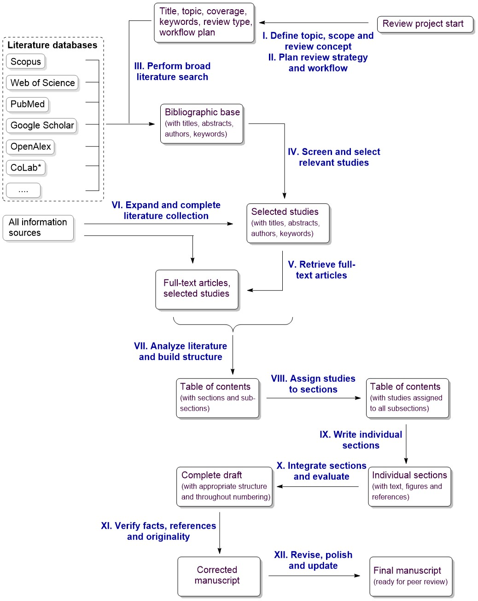

# Transparent Review Acceleration with Co-Expert AI: the TRACE Checklist
The TRACE checklist is a structured, stage-by-stage instrument for documenting how a review article was designed, executed, controlled, and finalized. It is suitable both for reviews written solely by humans and for reviews prepared with an AI co-expert. The checklist is designed to make the hidden methodological layer of review preparation visible.

The checklist follows the 12-stage TRACE framework described in the accompanying article. It records practical details at each stage – including review scope, time span covered, search keywords, databases used, record counts, deduplication and screening outcomes, full-text coverage, how studies were assigned to sections, verification steps, and final update procedures.

Review preparation stages of TRACE workflow* are summarized below:

*reprint from Russ. Chem. Rev., 95(11), RCR5239 (2026)

The latest checklist can be downloaded as a Word document: [TRACE_checklist.docx](https://github.com/DariArkh/TRACE_digital_co-expert/releases/latest/download/TRACE_checklist.docx)

We developed the TRACE checklist for authors of review articles; once completed and shared, it also serves readers, reviewers, and editors. The completed checklist should be submitted for publication as Supplementary material together with the corresponding review article.
## Citation
V.P. Ananikov, D.M. Arkhipova, A.S. Kashin, A.P. Vorozhtsov. [Writing review articles with AI: the TRACE digital co-expert approach]( https://doi.org/10.59761/RCR5239). Russ. Chem. Rev., 95(11), RCR5239 (2026); DOI:10.59761/RCR5239 
## Usage
License?

The latest checklist can be downloaded as a Word document: [TRACE_checklist.docx](https://github.com/DariArkh/TRACE_digital_co-expert/releases/latest/download/TRACE_checklist.docx)
### Worked example
A worked example is provided to show how the checklist can be filled in practice.

The fulfilled TRACE_checklist_v1.0 can be downloaded as a PDF document: [Worked_Example.pdf](Worked_Example.pdf?raw=true)

D.A. Arkhipova, A.S. Kashin, A.P. Vorozhtsov, V.P. Ananikov. [Synthetic data in electron microscopy. AI co-expert-assisted review](https://doi.org/10.59761/RCR5240). Russ. Chem. Rev., 95(11), RCR5240 (2026); DOI:10.59761/RCR5240 
## Language
English
## Contact
Valentine P. Ananikov (E-mail: val@ioc.ac.ru)